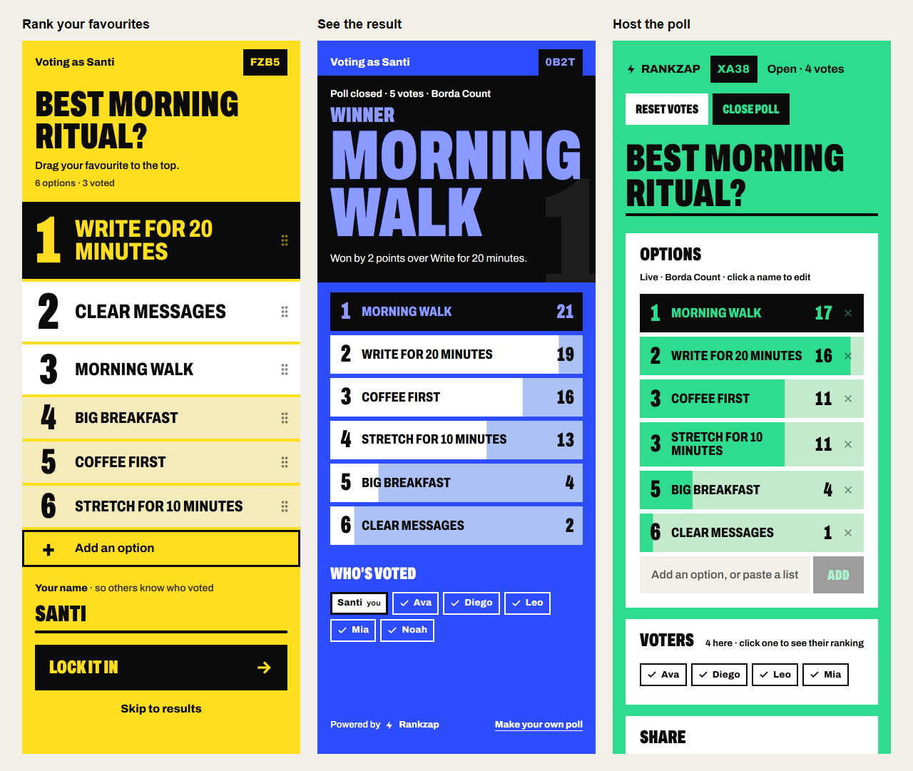

<p align="left">
  
</p>

[Live app](https://rankzap.site)



Screenshots use demo data rendered by the real app components. [Desktop host view](./public/rankzap-admin.png).

Real-time, mobile-first ranked-voting app. Drag to rank, submit, see live tallies. The Podium design uses condensed Archivo type, a staircase ballot, and bold colour. Home stays brand yellow; hosts can choose from eight poll colours when creating a poll or change the colour later. The current design uses a light theme.

- Create a poll, join with a four-character code, or reopen your recent polls from Home.
- Two pages per poll: an **admin** view (`/:roomId/admin`) and a **voter** view (`/:roomId`).
- Three tally modes: **Borda Count**, **Dowdall**, **Copeland**.
- Real-time sync, presence (online / voting / editing / voted indicators) and storage through its own small server: one Cloudflare Durable Object per poll (`worker/`).
- Poll IDs are 4-character uppercase alphanumeric (e.g. `A3ZK`). URLs are normalised to uppercase on load.
- The app and the poll server deploy together as one Cloudflare Worker.

## Stack

- Vite 8 + React 19 + TypeScript 6
- `react-router-dom` 7 (`BrowserRouter`)
- `@dnd-kit/core` + `@dnd-kit/sortable` for drag-to-rank
- `tailwindcss` v4 with semantic colour tokens, eight per-poll palettes, and reduced-motion support
- `nanoid` for voter IDs
- `qrcode` for the admin's share QR
- Cloudflare Workers + Durable Objects for the poll server, with `@cloudflare/vite-plugin` running it inside `npm run dev`

## Local development

```bash
npm install
npm run dev        # the app and the poll server, on one port
```

Use **Node `^20.19` or `≥22.12`** (same as Vite 8 / Rolldown).

There's nothing to configure. `npm run dev` runs the Worker in `worker/` (the poll server) inside Vite, using Cloudflare's local runtime. Local polls are stored in `.wrangler/` and survive restarts.

To try it on a phone privately with Tailscale, add the computer's Tailscale hostname to `VITE_DEV_ALLOWED_HOSTS` in `.env.local` (see `.env.example`), restart `npm run dev`, and run `tailscale serve --bg --https=8443 http://127.0.0.1:5173` (use the port Vite prints). Open the HTTPS link on a phone signed in to the same tailnet. Polls connect over that same address.

```bash
npm run build        # → dist/client (app) and dist/rankzap (Worker)
npm run preview      # serve the built bundle locally, Worker included
npm run cf-typegen   # regenerate worker/worker-configuration.d.ts after editing wrangler.jsonc
```

## Deployment to Cloudflare

The app and the poll server are one Worker, configured in `wrangler.jsonc`: the Worker answers `/api/*`, and every other path is the built app (unknown paths get `index.html`, so deep links work).

From your machine:

```bash
npx wrangler login   # once
npm run deploy       # build, then wrangler deploy
```

From GitHub: `.github/workflows/deploy.yml` deploys on every push to `main`. Add two repository secrets under **Settings → Secrets and variables → Actions**: `CLOUDFLARE_API_TOKEN` (a token from the "Edit Cloudflare Workers" template) and `CLOUDFLARE_ACCOUNT_ID`.

To use your own domain, add it to the Worker under **Workers & Pages → rankzap → Settings → Domains & Routes** in the Cloudflare dashboard.

## How it works

### Routing

| Path | Page |
|---|---|
| `/` | **Home** — create a poll with a colour, join by code, or reopen a recent poll from this device. |
| `/:roomId/admin` | Admin — edit title/options, inspect voters, change colour/scoring/settings, close/reset, share link and full-screen QR. |
| `/:roomId` | Voter — drag to rank, add your name as you lock in your vote, watch results, see the final winner. |

Anything else redirects to `/`. Lowercase room IDs in the URL are silently redirected to their uppercase canonical form.

### Poll server

Each poll is one Durable Object (`worker/pollRoom.ts`), named by its code. It keeps the whole poll in memory and in its storage:

```
state       "open" | "closed"
settings    { tallyMode, ballotTitle, showLiveResults, allowRevote, allowAdd, showUsers, showVoterVotes, colour? }
options     { id, text, addedBy, addedAt }[]
users       { id, name, mode: "idle" | "voting" | "editing", ignored? } by user id
votes       { userId, ranking: string[], submittedAt, ignored? } by user id
```

Who's online isn't stored: it's the set of voters with an open WebSocket.

Browsers connect with a WebSocket (`/api/polls/:id/ws`) and send actions (`join`, `vote`, `addOptions`, `updateSettings`, `setState`, …; see `src/lib/protocol.ts`). The server checks each action, saves the change, and sends every connection a fresh snapshot. Options a voter adds while ranking are saved together with their vote.

HTTP endpoints cover what doesn't need a live connection:

| Request | Does |
|---|---|
| `POST /api/polls` | Create a poll. Returns its code and a host key. |
| `GET /api/polls/:id` | Title, colour, state and first options, for Home's recent polls. |
| `DELETE /api/polls/:id` | Delete a poll. Needs the host key. |

A poll nobody has touched for 30 days deletes itself, and a poll that was created but never set up deletes itself after a day.

`mode` semantics:
- `"voting"` — voter is on the compose tab and has never submitted a vote
- `"editing"` — voter is on the compose tab, has submitted before, and their current ranking differs from the submitted one (submit button re-enabled)
- `"idle"` — everything else

### localStorage layout (admin/voter strictly isolated)

```
rankzap:admin:lastRoomId           # last poll this browser created
rankzap:admin:recentPolls          # recent host polls on this device ({ roomId, savedAt }[])
rankzap:vote:userId                  # global voter identity
rankzap:vote:name                    # last entered display name
rankzap:host:keys                    # host keys for polls this browser created ({ [pollId]: key })
rankzap:room:{roomId}:vote:rank      # voter's local drag order (saved on every drag-end)
```

### Tally

All three modes filter votes against the current option set on read. Results are sorted by score desc, ties broken by `addedAt` ascending.

| Mode | Score |
|---|---|
| Borda | 1st = `N-1`, 2nd = `N-2`, …; unranked = 0 |
| Dowdall | 1st = 1, 2nd = ½, 3rd = ⅓, …; unranked = 0 |
| Copeland | Per pair (A,B): +1 to the option more voters preferred, +0.5 each on tie. |

### Privacy / trust model

Creating a poll returns a secret host key, kept in that browser's localStorage. Only connections with the key can change the poll, and `/:id/admin` shows "Not your poll" without it. Clearing the browser's storage loses host access.

Voters aren't authenticated: anyone with the link can vote, and voter IDs live in localStorage, so a voter can vote again from another browser. Don't use this for sensitive or binding ballots.

## Project layout

```text
worker/
  index.ts                       # Routes /api/polls to each poll's Durable Object
  pollRoom.ts                    # One poll: storage, actions, WebSockets, expiry
  worker-configuration.d.ts      # Generated by `npm run cf-typegen`
src/
  main.tsx                       # React root and router
  App.tsx                        # Lazy-loaded routes
  styles/index.css               # Podium colour/type/motion tokens
  lib/
    protocol.ts                  # Messages and types shared with the poll server
    pollConnection.ts            # WebSocket to one poll: reconnects, snapshots, actions
    poll.tsx                     # PollProvider and usePoll
    pollApi.ts                   # HTTP calls: create, summary, delete
    pollColour.ts                # Applies a poll's palette; restores yellow on Home
    types.ts                     # Data types, palette table and length limits
    tally.ts                     # Borda, Dowdall and Copeland
    storage.ts                   # Admin/voter localStorage helpers
    identity.ts                  # Voter identity and display name
    adaptiveSize.ts              # Fits type to the length of an option or question
    url.ts                       # Voter/admin URL builders
  pages/
    Home.tsx                     # Create, join by code and recent host polls
    Layout.tsx                   # Connects to the poll, builds poll data, applies the colour
    AdminPage.tsx
    RankzapPage.tsx
    poll/
      AdminView.tsx              # Responsive host panels and poll actions
      VoterView.tsx              # Name and ballot flows
      VoterResults.tsx           # Submitted/closed results, ties and sharing
      shared.tsx                 # Shared poll data type, modal, header and footer
  components/
    ColourPicker.tsx            # Eight accessible colour swatches
    ArrangeOptions.tsx          # dnd-kit staircase ballot
    LiveOptions.tsx             # Live score bands, inline edit and option removal
    AddOption.tsx               # Single-add and multiline paste
    SubmitVote.tsx              # Vote submission, progress and errors
    UsersList.tsx               # Participants and selectable voter tags
    UserPill.tsx                # Presence/vote status tags
    VoterRankingPanel.tsx       # Individual ranking list
    Settings.tsx               # Host panels, scoring and switches
    ShareLink.tsx              # Share panel and full-screen QR
    Arrow.tsx
    Punch.tsx                   # Feedback when a score or rank changes
```

`design-explorations/` contains the original directions, the approved Podium mockup, and local preview harnesses. Harness data is fake and is not included in the production app.

## License

MIT
