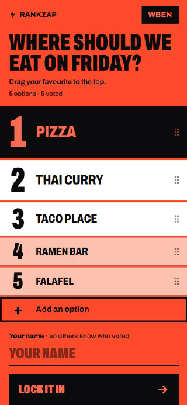
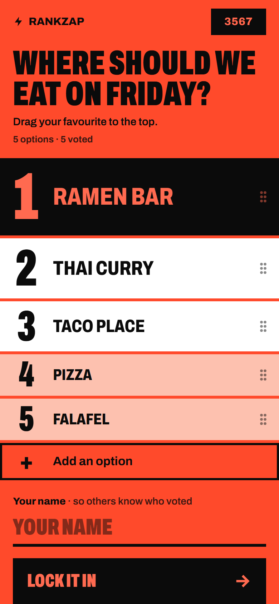
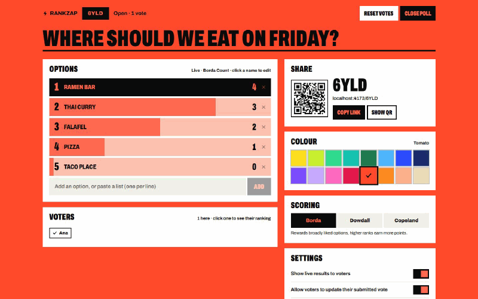
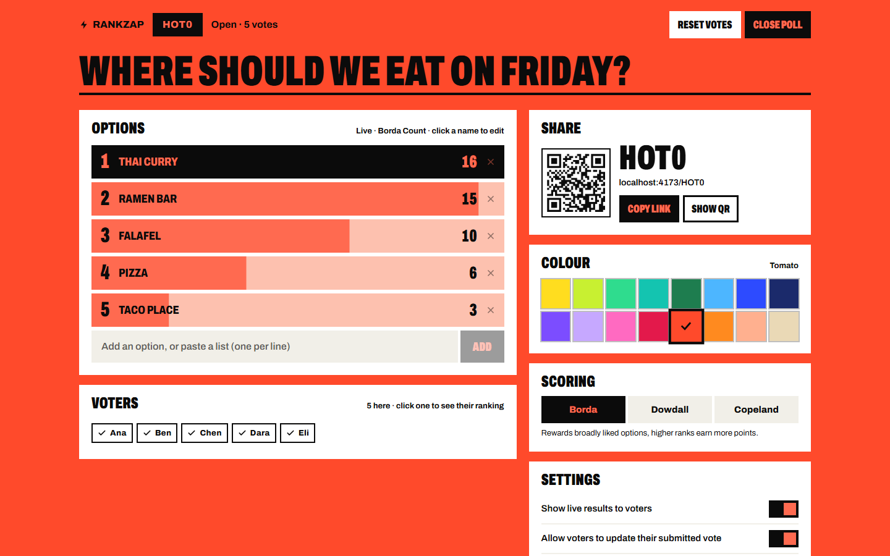
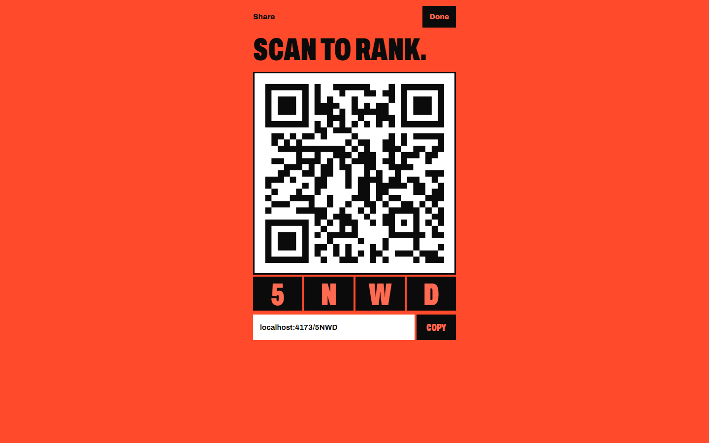
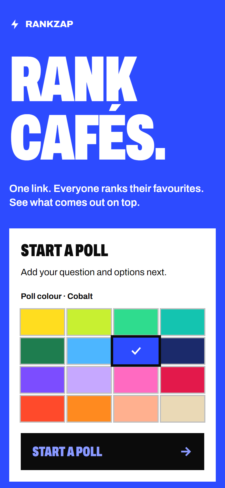

<p align="left">
  
</p>

Rankzap runs live ranked-choice polls: share one link, everyone drags the options into order, and the tally updates as votes arrive.

**[Open Rankzap](https://rankzap.site)** · [Docs](docs/how-it-works.md)



## Features

<table>
<tr>
<td width="50%"></td>
<td><b>Drag to rank</b><br>Voters put every option in order on a staircase ballot, best at the top.</td>
</tr>
<tr>
<td width="50%"></td>
<td><b>Live host page</b><br>Scores, voters and presence update over a WebSocket as each vote arrives.</td>
</tr>
<tr>
<td width="50%"></td>
<td><b>Three scoring methods</b><br>Hosts switch between Borda Count, Dowdall and Copeland at any time.</td>
</tr>
<tr>
<td width="50%"></td>
<td><b>Join by code or QR</b><br>A four-character code and a full-screen QR code bring a room in.</td>
</tr>
<tr>
<td width="50%"></td>
<td><b>A colour per poll</b><br>Each poll takes one of sixteen colours; hosts can change it later.</td>
</tr>
</table>

## Quick start

```sh
git clone https://github.com/santistebanc/rankzap.git
cd rankzap
npm install
npm run dev   # → the app and the poll server on one port (Vite prints the URL)
```

Use Node `^20.19` or `>=22.12`. Nothing needs configuring: local polls are stored in `.wrangler/`.

## How it's built

- **Frontend:** Vite, React 19 and TypeScript; `@dnd-kit` for drag-to-rank and Tailwind CSS v4 with per-poll colour tokens.
- **Poll server:** one Cloudflare Durable Object per poll keeps the poll, checks each action and pushes a fresh snapshot to every WebSocket.
- **Trust model:** creating a poll returns a secret host key kept in the browser; voters are not authenticated, so polls are not for binding ballots.
- **Deployment:** the app and the poll server ship as one Cloudflare Worker; GitHub Actions deploys every push to `main`.

## More

- [How it works](docs/how-it-works.md): local development, deployment, routing, the poll server, tally rules and project layout.
- [Media and capture config](docs/media/), refreshed with the project-showcase capture script (`docs/media/seed.mjs` creates the demo polls).
- `design-explorations/`: the original design directions and the approved Podium mockup.

## License

MIT.
